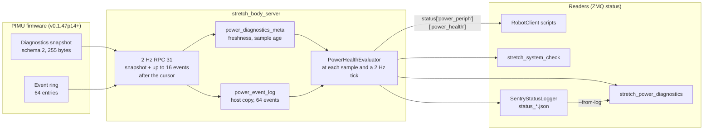

# Power Diagnostics Primer

The PIMU (power and IMU board, `power_periph` in Stretch Body) owns the battery path, the adapter and charger, the NUC and actuator rails, and the power-state machine that sleeps and shuts down the robot. From firmware `hello-pimu2.v0.1.47p14` on, it also reports what it is doing and why: a 255-byte diagnostics snapshot and a log of power events, read by `stretch_body_server` twice a second.

This primer covers what the PIMU reports, how it reaches your code, the plain-language health the server derives from it (`power_health`), the `stretch_power_diagnostics` tool, and how long the status logs keep it.

> The server is the only process that talks to the PIMU. Everything here reads the server's status over ZMQ (see [Robot Client API](primer_robot_client.md)). Never open `/dev/hello-pimu` or `/dev/hello-power-periph` yourself while the server runs.

## 1. Quick Start

On the robot, with the server running:

```bash
stretch_power_diagnostics              # one report
stretch_power_diagnostics --watch      # refresh every second until Ctrl-C
stretch_power_diagnostics --json       # the same report as JSON
stretch_power_diagnostics -n 30        # show the last 30 power events
```

From a script:

```python
from stretch4_body.robot.robot_client import RobotClient

with RobotClient() as robot:
    robot.pull_status()
    pp = robot.status['power_periph']
    health = pp['power_health']
    print(health['level'], health['summary'])
    for check in health['checks']:
        if check['level'] != 'ok':
            print(check['id'], check['level'], check['message'])
    d = pp['power_diagnostics']
    if d.get('_valid'):
        print('pack %.2f V, INA228 %s mV, ADC stale mask %s' % (
            d['battery_voltage_v'], d.get('ina_vbat_mv'), d.get('adc_stale')))
```

Reading status sends no commands, so this does not take the motion lease and is safe next to a running application.

## 2. What the PIMU Reports and Why

Before P14 the host saw a handful of PIMU values (voltage, current, SoC, runstop) and nothing about why the robot slept, shut down, stopped charging or rebooted. Field returns came back as "it turned off". The P14 diagnostics close that gap:

| Area | What is reported | Why it matters |
|---|---|---|
| Power state | State, last transition and its reason, runstop cause, peripheral rail mask | Tells "user pressed the button" from "low battery" from "ESP asked to sleep" |
| BMS link | Last good sample age, valid replies, CRC, timeout, overflow and protocol error counters, last failure detail | The firmware holds low-battery and charger decisions on a BMS sample older than 5 s |
| Battery | Pack voltage and current, SoC, SoH, cycles, cell and FET temperatures, alarm and MOS masks | The numbers behind every battery decision |
| INA228 witness (.43) | VBAT and current measured on the PIMU, independent of the BMS | A second opinion on pack voltage; catches a BMS that reports wrong values |
| ESP link | Status age, packet and error counters, frame length and unknown-id rejects (.42), shutdown command resends (.48) | The ESP carries the 12 V and 20 V readings, the NUC on/off signal and the adapter detect bit |
| Adapter | PIMU 36 V measurement, ESP adapter bit, which one is trusted (.42), disagreement mask (.42) | Charging and wake decisions depend on adapter presence |
| Charger | Enable command, expected active, charger current, charge-stop state (.24) | Shows whether the firmware stopped charging and why |
| NUC shutdown wait (.27) | Whether the rails are held for the NUC, how long, how the last wait ended | Tells a clean NUC shutdown from rails cut under a running NUC |
| ADC banks (.39) | Stale mask, rebuild counters, which source the adapter check uses | Some boards stall an ADC sequencer; rails then read held values |
| PIMU health | Uptime, reset causes, loop time and overruns, board temperature | Reboots and overload of the PIMU itself |
| Event log | 64-entry ring of timestamped power events with two data words each | The sequence that led to a sleep, shutdown or charge stop |

The firmware side is specified in `stretch_firmware_ii/arduino/hello_pimu2/PROTOCOL_P14_POWER_DIAGNOSTICS.md`.

## 3. Data Path



How the server reads it:

* **One RPC, twice a second.** Every 0.5 s the server queues `RPC_GET_POWER_DIAGNOSTICS` (31) with the schema it wants, the sequence of the last event it holds, and room for 16 events. The reply (32) carries the snapshot and the next events. The request is collected without waiting in the 100 Hz control loop; a reply that has not come back after 2 s counts as a timeout.
* **Schema 2 first, schema 1 fallback.** The body asks for schema 2 (255 bytes, firmware `v0.1.47p14` and later). Firmware from `v0.1.18p14` to `v0.1.23p14` only knows schema 1 and answers `unsupported_schema`; the body then asks for schema 1 (the first 190 bytes) for the rest of the session. Every field added after schema 1 is then published as `None`, and the checks that need it say "not reported by this firmware".
* **P13 firmware.** Firmware without RPC 31 is read with the older aux RPC (13). `power_diagnostics` stays invalid and `power_health` says to update the PIMU.
* **Freshness.** When a sample lands, the server classifies the firmware's BMS and ESP ages, then keeps aging them on host time between samples, so a dead link turns stale without a new sample.
* **Events.** The server keeps its own copy of the last 64 events, adds wall-clock estimates, detects gaps (events it never saw) and PIMU reboots (uptime going backwards), and re-reads the ring from the start after a reboot.
* **Health.** `power_health` is recomputed when a diagnostics sample is ingested, when the request times out, and on a 2 Hz tick in between. It is never computed per 100 Hz cycle. One evaluation takes about 0.02 ms on a NUC.

## 4. Published Keys

Everything is under `status['power_periph']`. `RobotClient` also exposes the same dictionary as `status['pimu']`.

### 4.1 Top-level keys

| Key | Type | Meaning |
|---|---|---|
| `power_diagnostics` | dict | The decoded snapshot (section 4.2). `_valid` is False until the first good reply |
| `power_diagnostics_meta` | dict | How the server is reading the snapshot (section 4.3) |
| `power_event_log` | dict | The host copy of the event ring (section 6) |
| `power_health` | dict | Derived health (section 5) |
| `status_aux` | dict | Power state, runstop cause, motor sync count and BMS temperatures. Mirrored from the snapshot on P14, from RPC 13 on P13 |
| `status_aux_meta` | dict | Sample counters for `status_aux` and the last 64 observed power-state transitions (`transitions`) |
| `rpc_rejected` | dict | `count`, `last_request_id`, `last_reason`, `last_length` of RPC 38 replies: requests the firmware did not know |
| `rpc_reply_errors` | int | PIMU replies the body refused to decode (wrong length or id) since the server started |
| `rpc_reply_last_error` | str or None | What was wrong with the last refused reply |

### 4.2 `power_diagnostics`

Raw firmware units are kept (`_mv`, `_ma`, `_ms`); convenience floats in V, A and s are added. "S2" marks fields that are `None` on schema 1.

**Header and identity**

| Key | Type | Meaning |
|---|---|---|
| `schema_version` | int | 1 or 2 |
| `struct_size` | int | 190 or 255; must match the schema |
| `uptime_ms` | int | PIMU uptime |
| `sample_sequence` | int | Increments with every snapshot the PIMU builds |
| `reset_cause_raw`, `reset_causes` | int, list of str | Last reset cause bits and their names (`power_on`, `brownout_core`, `brownout_vdd`, `nvm`, `external`, `watchdog`, `system_request`, `backup`) |
| `capability_flags_raw`, `capabilities` | int, dict of bool | What this build supports: `bms_pack`, `bms_temperatures`, `bms_alarms`, `bms_mos_states`, `event_log`, `esp_status`, `bms_cell_voltages`, `bms_capacity`, `bms_balancing`, `bench_rig_build` (bit 9), `eye_readback`, `ina_vbat`, `simulated_battery` (bit 12) |
| `validity_flags_raw`, `validity` | int, dict of bool | Which parts hold real data now: `bms_sample`, `esp_status`, `analog_rails`, `bms_extended_sample`, `ina_sample` |
| `diagnostics_rpc_count`, `diagnostics_reply_bytes`, `diagnostics_lock_time_us`, `diagnostics_lock_time_max_us` | int | Firmware-side cost of building the reply |

**Power state**

| Key | Type | Meaning |
|---|---|---|
| `power_state`, `power_state_name` | int, str | `STATE_ACTIVE`, `STATE_SLEEP`, `STATE_SHUTDOWN` and so on |
| `power_transition_reason_raw`, `power_transition_reason` | int, str | Why the last transition happened: `boot_button`, `user_button`, `esp_sleep_request`, `host_sleep_trigger`, `low_battery`, `user_wake`, `esp_wake_request` and others |
| `power_transition_sequence`, `power_transition_timestamp_ms`, `power_transition_uptime_ms` | int | When the last transition happened |
| `runstop_cause_raw` | int | Runstop cause bits |
| `periph_power_state_raw`, `periph_power_state` | int, dict of bool | Rails to lift, the three base motors, arm and end of arm |
| `cpu_on_status` | bool | The ESP's NUC USB VBUS input. It says the NUC port has power, not that the OS runs |
| `power_button_raw`, `power_button_debounced`, `power_button_high_count` | bool, bool, int | The power button input |
| `wait_wake_ack`, `wait_sleep_ack` | bool | The PIMU is waiting for the ESP to confirm a wake or sleep |
| `wait_sd_ack` (S2) | bool | The PIMU is resending the shutdown command to the ESP. From `v0.1.48p14` it stays set for the whole SHUTDOWN dwell |
| `esp_shutdown_cmd_sends` (S2) | int | Shutdown command sends in the current or last dwell |

**BMS and battery**

| Key | Type | Meaning |
|---|---|---|
| `battery_voltage_mv` / `_v`, `battery_current_ma` / `_a` | int / float | Pack voltage and current from the BMS |
| `battery_soc`, `battery_soh`, `battery_cycles` | int | State of charge and health in percent, charge cycles |
| `battery_cell_temp_1_c` .. `_3_c`, `battery_ambient_temp_c`, `battery_mosfet_temp_c` | int | BMS temperatures in C |
| `bms_alarm_mask_raw`, `bms_alarms` | int, dict of bool | `total_voltage_high`, `cell_voltage_high`, `cell_voltage_difference_high` |
| `bms_mos_mask_raw`, `bms_mos_states` | int, dict of bool | `charge_current_limit`, `pre_discharge`, `discharging`, `charging` |
| `bms_sample_age_ms` / `bms_sample_age_s`, `bms_last_valid_ms`, `bms_sample_sequence` | int / float | Age and sequence of the last good BMS reply |
| `bms_valid_replies`, `bms_crc_errors`, `bms_timeouts`, `bms_rx_overflows`, `bms_protocol_errors` | int | Counters since PIMU boot |
| `bms_consecutive_failures` | int | Failed polls since the last good one |
| `bms_last_failure_event`, `bms_last_failure_rx_len`, `bms_last_failure_function`, `bms_last_failure_exception_code`, `bms_last_failure_address` | int | Detail of the last failed poll |

**INA228 witness (S2, v0.1.43p14)**

| Key | Type | Meaning |
|---|---|---|
| `ina_vbat_mv` | int | VBAT measured by U2 across R13 (5 mOhm, between PROTECTED_VBAT and VBAT) |
| `ina_current_ma` | int | Current through R13. The sign convention is not yet confirmed on a bench |
| `ina_flags` | int | Bit 0: the part answered its device id at boot. Bit 1: the last read succeeded |

**ESP link, adapter and charger**

| Key | Type | Meaning |
|---|---|---|
| `esp_status_age_ms` / `esp_status_age_s` | int / float | Age of the last ESP status frame |
| `esp_rx_packets`, `esp_requests_sent` | int | Frames received from and sent to the ESP |
| `esp_crc_errors`, `esp_rx_overflows`, `esp_tx_queue_drops` | int | UART error counters |
| `esp_rx_length_errors`, `esp_rx_unknown_ids` (S2) | int | CRC-valid frames rejected by the per-id length check or with an unknown id |
| `esp_tx_mark_resets` (S2) | int | Times the transmit ring mark watchdog fired; nonzero is a firmware bug |
| `esp_adapter_connected`, `esp_adapter_fault`, `esp_network_connected`, `esp_firebase_configured` | bool | Bits from the ESP status frame |
| `adapter_voltage_present` | bool | The adapter presence the firmware acts on |
| `adapter_presence_source`, `adapter_presence_source_name` (S2) | int, str | Where that presence comes from: 0 `adc`, 1 `esp_fallback` (ADC0 stale), 2 `held` (ADC0 stale and ESP not fresh) |
| `esp_adapter_disagree`, `esp_adapter_disagree_name` (S2) | int, str | 0 `agree`, 1 `esp_only` (ESP says adapter, no 36 V), 2 `voltage_only` (36 V, ESP bit clear), 3 `both`. Set after 1 s of disagreement |
| `charger_enable_command` | bool | The firmware's charger enable output |
| `charger_expected_active` | bool | Adapter present and enable commanded. Not proof the charger IC runs |
| `user_charger_control` | bool | The host has taken charger control |
| `charger_current_ma` / `_a` | int / float | Measured charger current |
| `charge_stop_state`, `charge_stop_state_name`, `charge_stop_enabled` (S2) | int, str, bool | Low nibble: 0 `idle`, 1 `arming`, 2 `hold`. Bit 4: the policy is compiled in |

**Rails, NUC wait and ADC**

| Key | Type | Meaning |
|---|---|---|
| `voltage_cpu_mv`, `voltage_5v0_mv`, `voltage_36v0_mv`, `voltage_12v0_mv`, `voltage_20v0_aux_mv`, `current_cpu_ma` (and `_v`, `_a`) | int / float | Rail measurements |
| `shutdown_wait_active` (S2) | bool | Rails are held while the NUC shuts down |
| `shutdown_wait_elapsed_ms`, `shutdown_wait_cap_ms` (S2) | int | Time held so far and the cap (90000 ms) |
| `shutdown_wait_count` (S2) | int | Waits since PIMU boot |
| `shutdown_wait_last_end`, `shutdown_wait_last_end_name` (S2) | int, str | 0 `no_wait_configured`, 1 `nuc_off`, 2 `cap`, 3 `cancelled_by_wake`, 4 `cap_stale_off`, 255 `none_since_boot` |
| `shutdown_wait_last_duration_ms` (S2) | int | Length of the last wait |
| `adc_stale` (S2) | int | Bit 0 ADC0 (5 V, 36VDD, temperature), bit 1 ADC1 (charger, 20 V, CPU and EOA current). A stale bank's readings are held |
| `adc_reinit_cnt` (S2) | list of 2 int | Rebuilds of ADC0 and ADC1 since boot |

**PIMU loop, eyes and easter egg**

| Key | Type | Meaning |
|---|---|---|
| `pimu_temp_centi_c` / `pimu_temp_c` | int / float | Board temperature |
| `loop_time_us`, `loop_time_max_us`, `loop_overrun_count` | int | The 250 Hz handler's time, its maximum and overruns past 4 ms |
| `motor_sync_cnt` | int | Motor sync pulses |
| `eye_left`, `eye_right`, `eye_overlay` (S2) | dict, int | Eye LED readback |
| `easter_egg_mode` (S2) | int | Easter egg state |
| `_valid`, `_packet_length`, `_decode_error` | bool, int, str | Decoder bookkeeping |

### 4.3 `power_diagnostics_meta`

| Key | Type | Meaning |
|---|---|---|
| `available` | bool | The last request produced a valid snapshot |
| `sample_seq` | int | Host count of ingested snapshots |
| `sample_wall_time_s`, `sample_monotonic_s`, `sample_age_s` | float | When the last snapshot arrived and how old it is |
| `sample_interval_target_s` | float | 0.5 |
| `request_errors`, `request_timeouts` | int | Failed and timed-out requests since the server started |
| `request_latency_s`, `request_latency_max_s` | float | Request to reply time |
| `transport_error`, `schema_error` | str or None | Why the last request failed |
| `bms_freshness`, `esp_freshness` | str | Live class: `fresh`, `warning`, `fault`, `unavailable` (none since boot), `stale` (link down), `unknown` |
| `bms_age_s`, `esp_age_s` | float | Live age: firmware age at the sample plus host time since |
| `bms_freshness_at_sample`, `esp_freshness_at_sample` | str | The class when the sample was taken, so a reader can tell a stale link from a BMS or ESP outage |
| `pimu_boot_count_observed` | int | PIMU reboots seen while the server ran |
| `firmware_version`, `protocol_version` | str | From the PIMU board info at startup, for example `hello-pimu2.v0.1.48p14` and `p14` |

## 5. Power Health

`status['power_periph']['power_health']` turns the snapshot into levels and sentences:

```python
{
    'format': 1,
    'level': 'warn',                   # ok, warn, fault or unknown
    'summary': 'warn: adc_banks.',
    'evaluated_wall_time_s': 1792178405.2,
    'sample_seq': 3612,                # power_diagnostics_meta['sample_seq'] judged
    'counts': {'ok': 17, 'warn': 1, 'fault': 0, 'unknown': 0},
    'checks': [
        {'id': 'adc_banks', 'level': 'warn',
         'message': "1 ADC bank rebuild in the last minute: this board's ADC sequencer is stalling.",
         'values': {'adc_stale': 0, 'adc_reinit_cnt': [1, 0], 'adc_reinit_last_min': 1, ...}},
        ...
    ],
}
```

### 5.1 Levels

| Level | Lamp | Meaning |
|---|---|---|
| `ok` | `[ OK  ]` | Judged and healthy |
| `warn` | `[WARN ]` | Something is degraded or unusual. The robot keeps working; find out why |
| `fault` | `[FAULT]` | A protection or measurement the robot relies on is not working |
| `unknown` | `[  ?  ]` | Not judged: the firmware does not report it, or there is no sample yet |

The overall level is the worst check, with `fault` above `warn`. `unknown` checks never raise it. If nothing warns or faults but the diagnostics link itself is not `ok`, the overall level is `unknown`: there is nothing current to judge. A schema 1 robot with everything else healthy is `ok` with several `unknown` checks, never `warn`.

Rates ("in the last minute") are the increase of a firmware counter across the samples of the last 60 s. The first sample after a server start has no rate yet. A counter that goes backwards (PIMU reboot) restarts its window.

### 5.2 Checks

Thresholds live in one place, `PowerHealthThresholds` in `stretch4_body/subsystem/power_health.py`. They are class constants, not robot params, because most mirror a firmware constant: changing one on a single robot would not change what the PIMU does.

| Check | Rule | Level | What to do |
|---|---|---|---|
| `diagnostics_link` | No sample yet | unknown | Wait a second after server start. If it persists, check the PIMU firmware answers RPC 31 |
| | Sample older than 2 s, or the last request failed | warn | Look at `power_diagnostics_meta.transport_error`. Other checks use the last sample |
| | Sample older than 10 s | fault | The PIMU has stopped answering. Check USB and `stretch_body_server --print` |
| | Replies rejected before any sample | warn | Version mismatch in the reply layout; check the pairing (section 9) |
| | Protocol p13 or older | unknown | Update the PIMU to `v0.1.47p14` or later |
| `firmware_build` | Capability bit 9 (bench rig, never shuts down on low battery) | fault | Reflash the release build. A fleet robot must never run this |
| | Capability bit 12 (simulated battery) | warn | RDK build; battery values are not real |
| `bms_freshness` | Last good BMS sample 3 s old | warn | Check the BMS data lead; the firmware holds battery decisions past 5 s |
| | 10 s old, or none since boot | fault | Check the pack, its data lead and the BMS |
| `bms_link_errors` | 3 failed polls in a row | warn | See `bms_last_failure_event` |
| | 6 or more poll errors in the last minute (10 percent of 1 Hz polls) | warn | Noisy UART or slow pack |
| | Short replies only (no extended sample) | warn | Cell temperatures, alarms and MOS states are missing |
| `esp_freshness` | ESP status 2 s old (the firmware's own stale mark) | warn | 12 V, 20 V and `cpu_on_status` are not current |
| | 5 s old, or none since boot | fault | Check the ESP is running and the PIMU to ESP UART |
| `esp_link_errors` | 10 or more CRC errors, RX overflows and TX drops in the last minute | warn | Check the UART harness and grounding |
| `esp_frame_errors` (.42) | 60 or more length or unknown-id rejects in the last minute (one a second at a 50 Hz poll) | fault | The ESP build sends a different `Esp_Status` layout. Pair hello_esp with this PIMU |
| | Any reject in the last minute | warn | A healthy link has none |
| | `esp_tx_mark_resets` nonzero | warn | Firmware bug with no known path; report it with the output |
| `adc_banks` (.39) | A bank stale | warn | Readings of that bank are held until the 1 s rebuild |
| | A bank stale for 5 s | fault | The rebuild is not recovering it; the rails it measures are not measured |
| | A rebuild in the last minute | warn | This board's ADC sequencer stalls (seen at about 1.5 per minute on board 5341D1FA) |
| | Rebuilds only longer ago | ok | Counts are in the message |
| `adapter_source` (.42) | Source 1 `esp_fallback` or 2 `held` | warn | ADC0 is stale; adapter presence is not measured by the PIMU |
| `adapter_agreement` (.42) | Any nonzero disagreement mask | warn | 1: ESP says adapter, no 36 V, check dock contacts and 36VDD. 2: 36 V but ESP bit clear, check the ESP adapter detect |
| `vbat_cross_check` (.43) | INA228 and BMS differ by 500 mV or more for 3 samples in a row | warn | Measure VBAT with a DMM and compare both |
| | Same, 2000 mV or more | fault | One of the two readings is wrong |
| | INA228 did not answer at boot, or its last read failed | warn | Check U2 and its I2C bus |
| | BMS not fresh at the sample, RDK build, or no INA in this build | unknown | Nothing to compare |
| `shutdown_wait` (.27) | Rails held for 80 percent of the 90 s cap | warn | The NUC has not reported off and will lose power at the cap |
| | Last wait ended at the cap (2) or at the cap with only stale "off" status (4) | warn | The NUC did not shut down in 90 s, or its state was never confirmed. Check the NUC shutdown path and ESP status |
| `shutdown_command` (.48) | `wait_sd_ack` set in ACTIVE | warn | Every transition clears it; report it |
| | Resending during SHUTDOWN | ok | Normal; up to about 900 sends across the 90 s dwell |
| `charge_stop` (.24) | Any state | ok | Information: idle, arming (alarm sustained 5 s) or hold (10 min dwell). Notes when the policy is compiled out |
| `rpc_rejections` | An RPC 38 rejection in the last minute | warn | The body sent a request this firmware does not know; check the pairing |
| | A refused reply in the last minute | warn | See `rpc_reply_last_error` |
| `pimu_reboots` | A reboot seen while the server ran | warn | See event 1 and its reset cause |
| | Last reset cause watchdog or brownout | warn | The PIMU restarted itself; check the supply and the log |
| `pimu_timing` | Any 250 Hz loop overrun in the last minute | warn | The PIMU is overloaded; note what the robot was doing |
| `event_log` | The host missed events (coverage gap) | warn | Events between the two sequences are lost to the host |
| | Firmware ring overwrote entries the host had already read | ok | Normal on a busy robot |
| | Not read yet | unknown | |

Why these numbers:

* **Link 2 s and 10 s.** The poll is 2 Hz and a reply times out after 2 s, so 2 s is four missed polls. Ten seconds without one means the PIMU has stopped answering.
* **BMS 3 s and 10 s.** The BMS is polled at 1 Hz; three failures in a row is 3 s. The firmware's own decision gate is 5 s, between the host warning and fault.
* **ESP 2 s and 5 s.** 2 s is the firmware's stale mark for ESP status.
* **ESP frame rejects 60 a minute.** The PIMU polls at 50 Hz, so one reject a second means most frames of some kind are refused.
* **ADC 5 s.** A bank is marked stale after 100 ms without a sweep and rebuilt after 1 s, so 5 s stale means several rebuilds failed.
* **VBAT 500 mV and 2 V.** The INA228 sits after the BMS FETs, fuse, harness and R13, the BMS before them, and the two readings are up to 1 s apart. At 10 A through about 30 mOhm of path plus the BMS's own error, 500 mV is the most an honest pair should differ. 2 V is beyond any drop the robot's current can make. A mismatch must hold for 3 samples (1.5 s) to count, which rejects load steps. These values need confirming on a bench robot with a DMM.
* **Shutdown wait 80 percent.** Gives about 18 s of warning before the 90 s cap cuts the NUC.

## 6. The Event Log

The PIMU records power events in a 64-entry ring, each with a sequence number, a timestamp in PIMU milliseconds, an id, a source, the power state at the time and two signed 16-bit data words. The server reads up to 16 new events per poll and publishes the last 64 as `power_event_log`:

| Key | Type | Meaning |
|---|---|---|
| `available` | bool | The last page decoded |
| `cursor_sequence` | int | Sequence of the newest event the host holds |
| `oldest_sequence`, `newest_sequence`, `retained_count`, `has_more` | int, int, int, bool | The firmware ring as of the last page |
| `firmware_dropped_count` | int | Entries the ring has overwritten since boot (normal once it wraps) |
| `coverage_gap_count`, `coverage_gaps` | int, list | Times the host saw a jump in sequence, with `after_sequence`, `resumed_sequence`, `detected_wall_time_s` (last 32 kept) |
| `reboot_pages_discarded` | int | Pages dropped because the PIMU rebooted between request and reply |
| `request_errors`, `request_timeouts`, `transport_error`, `schema_error`, `reply_status`, `reply_status_name` | | Read errors |
| `events` | list of dict | The last 64 events, oldest first |

Each event has `sequence`, `timestamp_ms`, `timestamp_s`, `event_id`, `event_name`, `explanation`, `source_raw`, `source` (`pimu`, `power_state`, `bms`, `esp`, `peripheral`, `runstop`), `power_state`, `power_state_name`, `data0`, `data1`, `received_wall_time_s`, and when the PIMU uptime is known, `uptime_ms` and `estimated_wall_time_s`. Transitions (id 2) add `from_state_name` and `transition_reason`.

`describe_power_event(event)` in `power_health.py` turns `data0` and `data1` into a sentence; the CLI prints it.

| Id | Name | data0, data1 |
|---|---|---|
| 1 | `boot` | Reset cause bits, board variant |
| 2 | `power_state_transition` | Previous state, transition reason |
| 3 | `button_raw_changed` | Old, new |
| 4 | `button_debounced` | Old, new (500 ms debounce) |
| 5 | `button_request` | Request, transition reason |
| 6 | `adapter_changed` | Old, new 36 V presence |
| 7 | `charger_enable_command_changed` | Old, new (the GPIO, not proof the charger runs) |
| 8 | `charger_expected_active_changed` | Old, new |
| 9 | `bms_sample_valid` | First good BMS reply after boot |
| 10 | `bms_timeout` | Consecutive failures, received bytes |
| 11 | `bms_crc_error` | Consecutive failures, received bytes |
| 12 | `bms_rx_overflow` | Consecutive failures, received bytes |
| 13 | `bms_recovered` | Failures before recovery, last failure event id |
| 14 | `bms_alarm_changed` | Old, new alarm mask |
| 15 | `bms_mos_changed` | Old, new MOS mask |
| 16 | `cpu_status_changed` | Old, new NUC VBUS input |
| 17 | `esp_status_recovered` | Age in ms, NUC VBUS |
| 18 | `esp_status_stale` | Age in ms, NUC VBUS (no status for 2 s) |
| 19 | `runstop_changed` | Runstop state or cause |
| 20 | `peripheral_state_changed` | Old, new rail mask |
| 21 | `cpu_power_cycle_request` | Host asked for a NUC power cycle |
| 22 | `esp_crc_error` | Total, frame length |
| 23 | `esp_rx_overflow` | Total, buffer index |
| 24 | `esp_tx_queue_drop` | Total, UART id |
| 25 | `bms_protocol_error` | Consecutive failures, exception code or length |
| 26 | `bms_boot_wait` | 1 present or 2 absent, wait in ms |
| 27 | `bms_decision_blocked` | 1 low-battery or 2 charger decision held, sample age in ms (32767: none) |
| 28 | `boot_watchdog_arm` | Arm value, reason (0 RDK, 1 no host config yet, 2 host `nuc_safe_shutdown`) |
| 29 | `shutdown_requested` | Transition reason, 1 when the rails wait for the NUC |
| 30 | `shutdown_nuc_notified` | UART message id, 4 ms ticks waited |
| 31 | `shutdown_nuc_wait_ended` | Cause (0 no wait, 1 NUC off, 2 cap, 4 cap with stale off), ticks waited |
| 32 | `shutdown_rails_down` | Rail mask (1 20V0, 2 5V0), starting reason |
| 33 | `shutdown_retargeted` | Transition reason, rail mask down |
| 34 | `shutdown_ended` | Wake reason, furthest step |
| 35 | `charge_stop` | Reason << 8 or SoC, cell max mV |
| 36 | `charge_restart` | Reason << 8 or SoC, pack mV |
| 40 | `adc_bank_reinit` | Bank (0 or 1), its rebuild count |
| 41 | `adc_stale_changed` | Old, new stale mask |
| 42 | `adapter_source_changed` | Old, new source (0 ADC, 1 ESP, 2 held) |
| 43 | `low_battery_qualified` | Cause bits (1 SoC 0, 2 undervoltage), consecutive low frames |
| 44 | `esp_request_rejected` | Request bits (1 sleep, 2 wake), rejections since boot |
| 45 | `esp_rx_length_error` | Error count (negative: unknown id count), id << 8 or payload length |
| 46 | `adapter_disagreement` | Old, new mask (1 ESP only, 2 voltage only) |
| 47 | `esp_shutdown_cmd_delivered` | Sends, ms since the first. Information only |
| 48 | `esp_trigger_dropped` | Dropped mask (1 host lidar-on, 2 host AUX-on, 4 wake AUX-on), where (1 at the ACTIVE exit, 2 requested outside ACTIVE). Source esp, firmware v0.1.49p14 and later. Information only |
| 50 | `easter_egg_entered` | 1 runstop hold, 2 host RPC 39 |
| 51 | `easter_egg_left` | 2 host RPC 39, 3 runstop |

## 7. `stretch_power_diagnostics`

```bash
stretch_power_diagnostics [--json] [--watch [--interval S]] [-n EVENTS] [--no-color]
stretch_power_diagnostics --from-log FILE [--at TIME] [--json] [-n EVENTS]
```

| Option | Meaning |
|---|---|
| `--json` | Print the report as JSON: `health`, `key_values`, decoded `events`, the meta and the raw snapshot |
| `--watch`, `--interval S` | Clear and refresh every S seconds (default 1) until Ctrl-C |
| `-n`, `--events N` | How many recent events to show (default 10, 0 hides them) |
| `--from-log FILE` | Read a status log file (`status_*.json`) or a `stretch_status --export` zip instead of the server |
| `--at TIME` | With `--from-log`: the sample at or before `HH:MM[:SS]` (local time on the log's first day), `+S` seconds from the start, `-S` from the end, or epoch seconds. Default: the last sample |
| `--no-color` | Plain lamps |

Exit status: 0 for ok, warn or unknown; 1 for fault (single report); 2 when the server is not running or has no PIMU.

The tool never opens a device. Live, it uses `RobotClient`; if the server is down it says so and stops:

```text
stretch_body_server is not running (no answer on its admin socket), so there is no power status to read.
Start it with: stretch_body_server --launch
For a robot that is off, read a status log instead: stretch_power_diagnostics --from-log <status_*.json>
```

When the server is older than this body and publishes no `power_health`, the tool computes it locally from the published snapshot and says so in the header.

A healthy robot:

```text
Stretch power diagnostics, stretch-se4-4056, live from stretch_body_server, 2026-10-16 14:20:05
PIMU firmware hello-pimu2.v0.1.48p14 (p14), diagnostics schema 2, sample 0.1 s old

Overall [ OK  ] All 18 judged checks ok.

  [ OK  ] Diagnostics link   Diagnostics arriving at 2 Hz on schema 2, last sample 0.1 s old.
  [ OK  ] Firmware build     Release firmware build.
  [ OK  ] BMS freshness      Last valid BMS sample 0.5 s ago.
  [ OK  ] BMS link errors    No BMS poll error in the last minute; 0 since boot.
  [ OK  ] ESP freshness      Last ESP status 0.1 s ago.
  [ OK  ] ESP UART errors    0 ESP UART errors in the last minute; 0 since boot.
  [ OK  ] ESP frame rejects  No ESP frame rejected in the last minute; 0 since boot.
  [ OK  ] ADC banks          Both ADC banks sweeping; no rebuild since boot.
  [ OK  ] Adapter source     Adapter presence comes from the PIMU's own 36VDD measurement.
  [ OK  ] Adapter agreement  The ESP adapter_connected bit and the 36 V input agree.
  [ OK  ] VBAT cross-check   INA228 VBAT 27.15 V and BMS pack 27.20 V agree within 50 mV (limit 500).
  [ OK  ] NUC shutdown wait  No NUC shutdown wait since PIMU boot.
  [ OK  ] Shutdown command   No shutdown command pending.
  [ OK  ] Charge stop        Charge-stop policy idle: the charger runs under the legacy 28 V / 26.8 V rules.
  [ OK  ] RPC rejections     No RPC rejected or malformed since the server started.
  [ OK  ] PIMU reboots       No PIMU reboot since the server started; up 1.5 h, reset cause power_on.
  [ OK  ] PIMU loop timing   No PIMU control-loop overrun in the last minute; max handler time 410 us.
  [ OK  ] Event log          No event missed and no firmware drop.

Key values
  Power state        STATE_ACTIVE (0), last transition boot_button (1)
  Battery (BMS)      27.20 V, 1.50 A, SoC 80 %, SoH 98 %, sample 0.5 s old
  INA228 witness     27.15 V, 1.48 A, flags 3
  Adapter            present no, ESP connected no, source adc (0), agreement agree (0)
  Charger            command off, expected active no, charger current 0.00 A, charge stop idle (0x10, policy on)
  Rails              NUC 19.7 V 2.10 A, 5V0 5.04 V, 36VDD 35.4 V, 12V0 12.0 V, 20V0 aux 19.8 V
  NUC shutdown wait  idle, last end none_since_boot (255), 0 waits since boot, cap 90 s
  Shutdown command   wait_sd_ack no, 0 sends
  ADC                stale mask 0x0, rebuilds since boot ADC0 0, ADC1 0
  PIMU               up 1.5 h, reset power_on, loop max 410 us, overruns 0, board 36.5 C

Last 2 power events (of 2 held, cursor 2, 0 gaps, firmware drops 0)
  #1  12:50:06.200  STATE_ACTIVE  boot (1): reset cause power_on; board variant 2
  #2  12:50:06.900  STATE_ACTIVE  bms_boot_wait (26): BMS present after 640 ms
```

A board whose ADC0 sequencer stalled ten seconds ago:

```text
Stretch power diagnostics, stretch-se4-4056, live from stretch_body_server, 2026-10-16 14:20:05
PIMU firmware hello-pimu2.v0.1.48p14 (p14), diagnostics schema 2, sample 0.1 s old

Overall [WARN ] warn: adc_banks.

  [ OK  ] Diagnostics link   Diagnostics arriving at 2 Hz on schema 2, last sample 0.1 s old.
  [ OK  ] Firmware build     Release firmware build.
  [ OK  ] BMS freshness      Last valid BMS sample 0.5 s ago.
  [ OK  ] BMS link errors    No BMS poll error in the last minute; 0 since boot.
  [ OK  ] ESP freshness      Last ESP status 0.1 s ago.
  [ OK  ] ESP UART errors    0 ESP UART errors in the last minute; 0 since boot.
  [ OK  ] ESP frame rejects  No ESP frame rejected in the last minute; 0 since boot.
  [WARN ] ADC banks          1 ADC bank rebuild in the last minute: this board's ADC sequencer is stalling.
  [ OK  ] Adapter source     Adapter presence comes from the PIMU's own 36VDD measurement.
  [ OK  ] Adapter agreement  The ESP adapter_connected bit and the 36 V input agree.
  [ OK  ] VBAT cross-check   INA228 VBAT 27.15 V and BMS pack 27.20 V agree within 50 mV (limit 500).
  [ OK  ] NUC shutdown wait  No NUC shutdown wait since PIMU boot.
  [ OK  ] Shutdown command   No shutdown command pending.
  [ OK  ] Charge stop        Charge-stop policy idle: the charger runs under the legacy 28 V / 26.8 V rules.
  [ OK  ] RPC rejections     No RPC rejected or malformed since the server started.
  [ OK  ] PIMU reboots       No PIMU reboot since the server started; up 1.5 h, reset cause power_on.
  [ OK  ] PIMU loop timing   No PIMU control-loop overrun in the last minute; max handler time 410 us.
  [ OK  ] Event log          No event missed and no firmware drop.

Key values
  Power state        STATE_ACTIVE (0), last transition boot_button (1)
  Battery (BMS)      27.20 V, 1.50 A, SoC 80 %, SoH 98 %, sample 0.5 s old
  INA228 witness     27.15 V, 1.48 A, flags 3
  Adapter            present no, ESP connected no, source adc (0), agreement agree (0)
  Charger            command off, expected active no, charger current 0.00 A, charge stop idle (0x10, policy on)
  Rails              NUC 19.7 V 2.10 A, 5V0 5.04 V, 36VDD 35.4 V, 12V0 12.0 V, 20V0 aux 19.8 V
  NUC shutdown wait  idle, last end none_since_boot (255), 0 waits since boot, cap 90 s
  Shutdown command   wait_sd_ack no, 0 sends
  ADC                stale mask 0x0, rebuilds since boot ADC0 1, ADC1 0
  PIMU               up 1.5 h, reset power_on, loop max 410 us, overruns 0, board 36.5 C

Last 3 power events (of 3 held, cursor 3, 0 gaps, firmware drops 0)
  #1  12:50:06.200  STATE_ACTIVE  boot (1): reset cause power_on; board variant 2
  #2  12:50:06.900  STATE_ACTIVE  bms_boot_wait (26): BMS present after 640 ms
  #3  14:19:55.000  STATE_ACTIVE  adc_bank_reinit (40): ADC0 rebuilt, count 1
```

### 7.1 Reading a status log

`--from-log` reads the files written by `SentryStatusLogger` (section 8). It keeps only the timestamp and `power_periph` of each sample, so a 200 MB minute file takes about 2 s and 500 MB of memory. If the file is damaged (a cut-short write, a splice, a file that starts mid-sample) the reader skips to the next sample boundary, carries on, and says how many damaged spots it skipped.

If the logged samples carry `power_health`, the report uses it as logged. For logs from a body without `power_health`, the tool replays the evaluator over the two minutes of samples before the chosen one, so the one-minute rates are real.

```bash
# What did the power path look like at 14:19:50 on that robot?
stretch_power_diagnostics --from-log status_20261016_142003.json --at 14:19:50
# 20 s before the end of the file, as JSON
stretch_power_diagnostics --from-log status_20261016_142003.json --at -20 --json
```

### 7.2 In `stretch_system_check`

The Power & Battery section of `stretch_system_check` prints one line from `power_health`, for example `[PASS] P14 power health: All 18 judged checks ok.` or `[WARN] P14 power health: warn: adc_banks. Details: stretch_power_diagnostics`. A fault fails the section. The line is absent when the server publishes no `power_health`.

## 8. Status Log Retention

`SentryStatusLogger` (see [Robot Status Data and Server Logs](primer_status_log.md)) records the full RobotClient status, including everything in this primer:

| Item | Value |
|---|---|
| Rate | `check_rate`, 100 Hz in `robot_params_SE4.py` (about 97 Hz achieved) |
| Batch | One JSON array file per 60 s, `status_<YYYYmmdd_HHMMSS>.json` |
| Where | `$HELLO_FLEET_PATH/log/stretch_status/` |
| Cap | `maximum_log_size_mb`, 5000 MB (MiB). The oldest files are deleted after each write |

Measured bytes per logged sample (`json.dumps`, as the logger writes):

| Content | Bytes per sample |
|---|---|
| Whole sample, June 2026 log from stretch-se4-4032, pre-P14 body | 37,285 |
| P14 keys, one copy, empty event log | 11,274 |
| P14 keys, one copy, full 64-event log | 40,832 |
| of which `power_event_log` with 64 events (about 460 B per event) | 29,770 |
| of which `power_diagnostics` | 4,604 |
| of which `power_health` | 4,298 |
| of which `status_aux_meta` (with transitions) | 1,293 |

`status['pimu']` is an alias of `status['power_periph']` in `RobotClient`, and the logger writes both, so every power byte is written twice.

| Body | Bytes per sample | Per minute | 5000 MB holds |
|---|---|---|---|
| Pre-P14 (measured) | 37,285 | 217 MB | about 24 minutes |
| P14, empty event log | about 59,800 | 348 MB | about 15 minutes |
| P14, full event log | about 118,900 | 692 MB | about 7.6 minutes |

So the status log is a flight recorder for the last few minutes, not hours. The event log is the part that grows: it fills over the first hours of a session and is then written in full, unchanged, 97 times a second. The PIMU itself keeps the last 64 events across a host restart, so after an incident read them live first.

To pull logs off a robot, from your workstation:

```bash
# Everything the logger holds (HELLO_FLEET_PATH is ~/stretch_user on a robot)
rsync -av hello-robot@stretch-se4-4056.local:stretch_user/log/stretch_status/ ./4056_status/
# or on the robot, one zip of all files, then copy it off
stretch_status --export ~/
```

Copy the logs soon after the incident: at 7 to 15 minutes of history, a robot left running overwrites the moment you care about.

## 9. Version Pairing

| PIMU firmware | Body | What you get |
|---|---|---|
| `v0.1.47p14` or later (schema 2) | `c11d9fe` or later on `feature/firmware-p14` | Everything in this primer |
| `v0.1.18p14` to `v0.1.23p14` (schema 1) | same | Schema 1 snapshot; S2 fields `None`, their checks `unknown` |
| p13 or older | same | Aux status only; `power_health` asks for a PIMU update |
| `v0.1.47p14` or later | older than `c11d9fe` | Schema 1 requested and served; no `power_health` (the CLI computes it locally) |

`v0.1.48p14` changes only how long `wait_sd_ack` stays set; the snapshot layout is the same.

## 10. Where the Code Is

| File | Role |
|---|---|
| `stretch4_body/subsystem/power_periph.py` | RPC 31 request, snapshot and event page decoding, enum names |
| `stretch4_body/robot/robot_server.py` | 2 Hz poll, freshness, event log, `power_health` publication |
| `stretch4_body/subsystem/power_health.py` | `PowerHealthThresholds`, `PowerHealthEvaluator`, `describe_power_event`, `health_line` |
| `stretch4_body/tools/stretch_power_diagnostics.py` | The CLI |
| `test/test_power_health.py`, `test/test_robot_server_power_health.py`, `test/test_stretch_power_diagnostics.py` | Every rule, the server wiring and the CLI, with no hardware |
